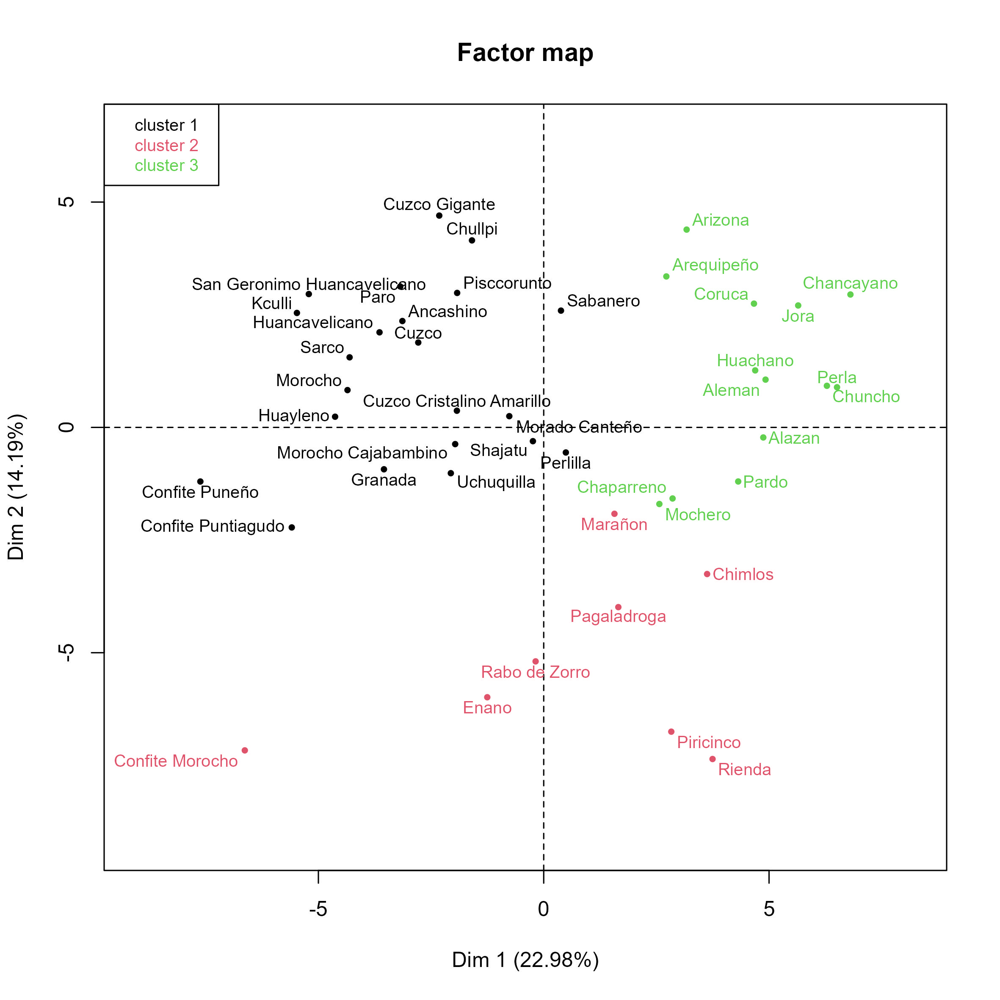
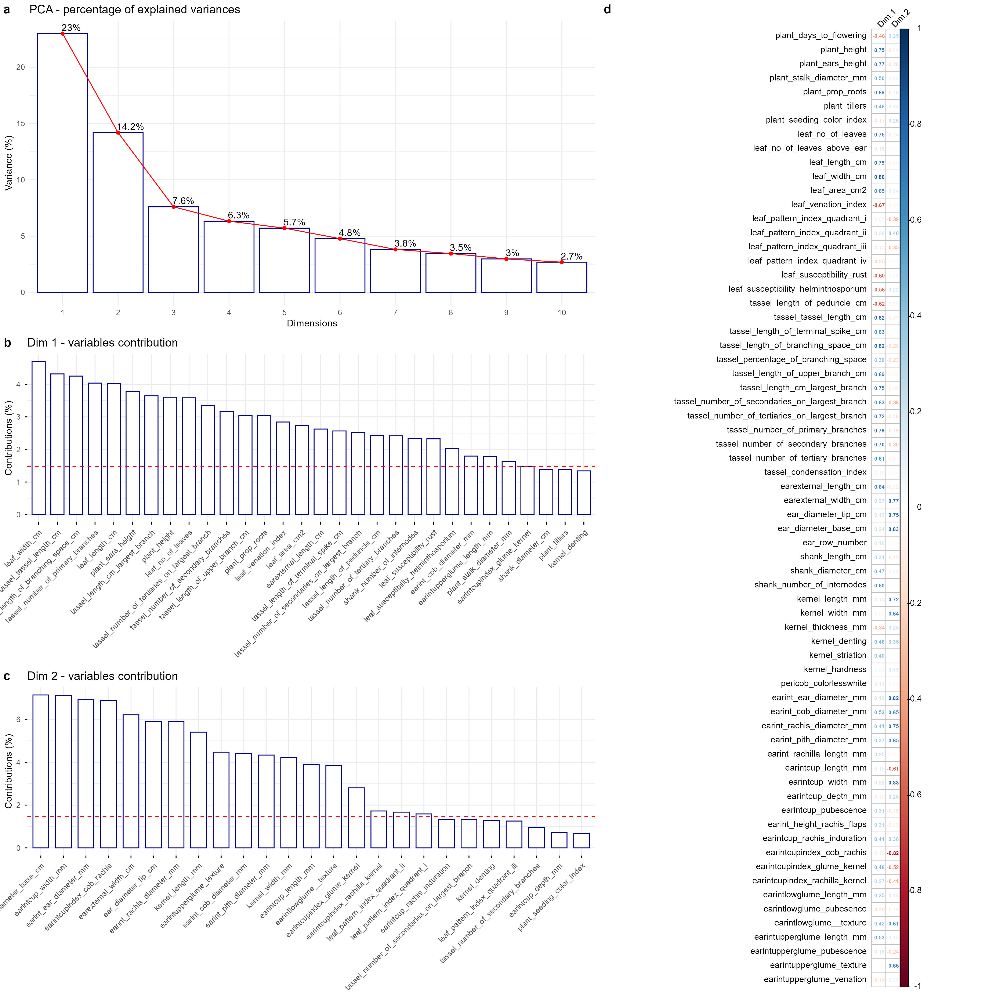
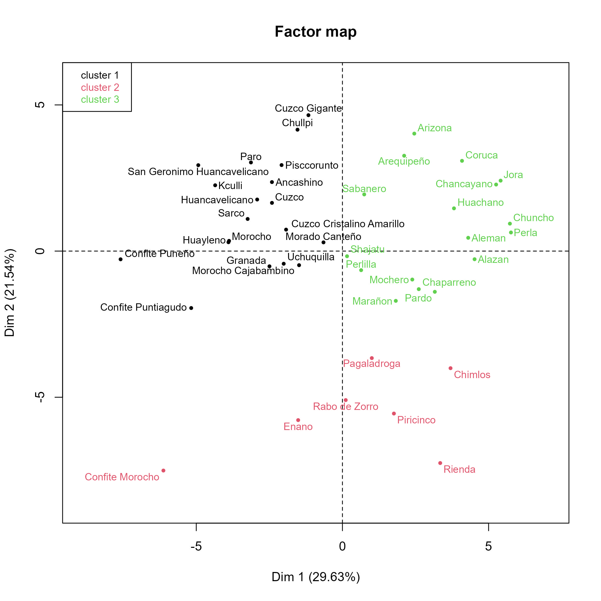
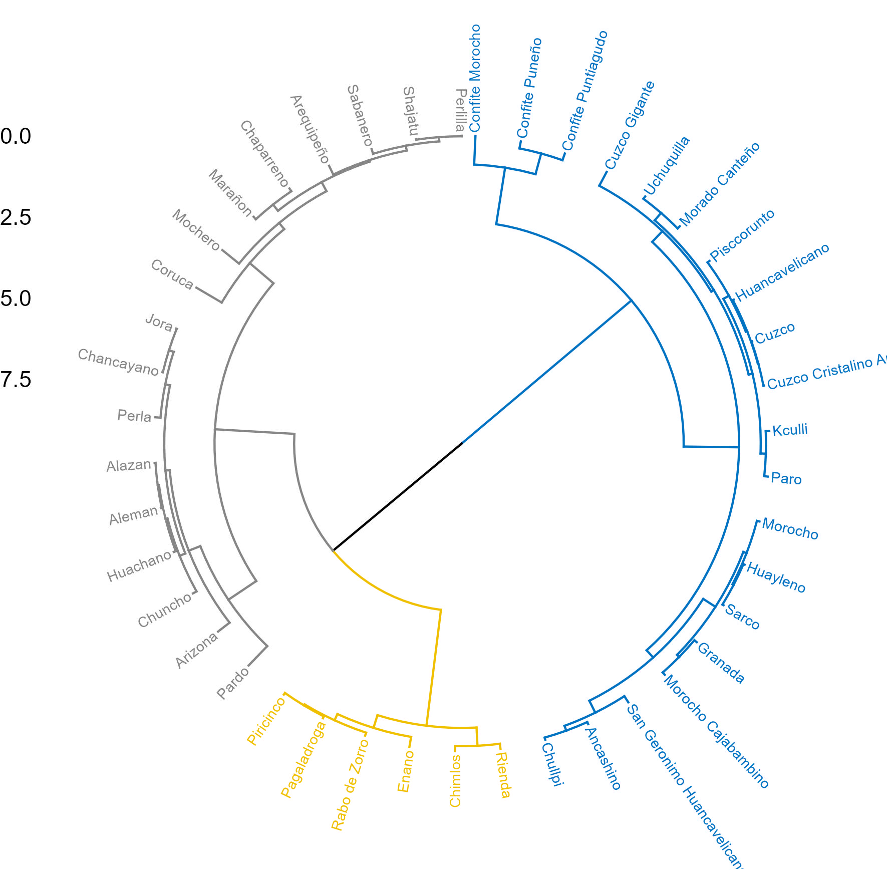

# Project Setup

```{r}
#| label:  setup

library(emmeans)
library(multcomp)
library(factoextra)
library(corrplot)
library(factoextra)
source('https://inkaverse.com/setup.r')

cat("Project: ", getwd(), "\n")
session_info()
```

# Import data

Data morfológica curada de los maíces amiláceos Peruanos de Grobman et al (1961). 

Análisis sugeridos: 

- PCA
- Análisis discriminante para determinar cuáles son las características que permiten reconocer a las razas de maíz Peruano. 
- Análisis de correlación
- Determinar número de grupos (K)
- Otros que consideres

```{r}
url <- "https://docs.google.com/spreadsheets/d/1Us3b4buA-tXxltZd1kd970NttFA4k_apQvLdQ8BXXTw/edit?gid=37859623#gid=37859623"

gs <- url %>% 
  as_sheets_id()

rawdata <- gs %>% 
  range_read("dt") 

fb <- rawdata %>% 
  select(where(~ mean(!is.na(.x)) >= 0.8)) %>% 
  rename_with(~ tolower(gsub(" ", "_", .x))) %>% 
  rename_with(~ tolower(gsub("\\(|\\)", "", .x))) %>% 
  mutate(across(1:plant_pubescence, ~ as.character(.))) %>% 
  mutate(across(1:plant_pubescence, ~ as.factor(.))) 
  
str(fb)
```

## Raw data

```{r}
rawdata %>% 
  web_table(caption = "raw-data")

rawdata %>% dim()
```

## Filtered data

- Traits with more 80% of information

```{r}
fb %>% 
  web_table(caption = "Filtered data")

fb %>% dim()
```

# Summary data

```{r}
smr <- fb %>% 
  summarise(across(where(is.numeric), list(mean = ~ mean(x = ., na.rm = T)
                                           , sd = ~ sd(x = ., na.rm = T)
                                           , min = ~ min(x = ., na.rm = T)
                                           , max = ~ max(x = ., na.rm = T)))) %>% 
  rowid_to_column() %>% 
  pivot_longer(!rowid) %>% 
  separate(name, c("trait", "stat"), sep = "_(?=[^_]+$)") %>% 
  pivot_wider(names_from = stat, values_from = value)
  

smr %>% kable()
```

# Multivariate analysis

Principal Component Analysis (PCA) of traits and their contributions.

```{r}
pca <- fb %>% 
  column_to_rownames(var = "race") %>% 
  PCA(scale.unit = T
      , quali.sup = 1:4
      , graph = F) 


var <- plot.PCA(pca, choix = c("var"), cex = 0.6)

var

ind <- plot.PCA(pca, choix = c("ind"), cex = 0.7
                , label = "ind"
                , invisible = "quali"
                , habillage = 1
                )

ind

# summary(pca, nbelements = Inf, nb.dec = 2)
# pcainfo <- factoextra::get_pca_var(pca)
# pcainfo$cor
# pcainfo$contrib
```

# Analisis de Cluster

```{r}
cls <- HCPC(pca, graph = F)

pclust <- \() {
  
  plot.HCPC(cls, choice = "map", nb.clust=-1, draw.tree = F)
  
}
  
plot <- list(pclust) %>% 
  plot_grid(plotlist = ., ncol = 1)

ggsave2(plot = plot, "submission/cluster.jpg"
        , height = 20, width = 20, units = "cm")


  
```

# Variable contribution

```{r}
cont <- fviz_eig(pca, 
                addlabels=TRUE,
                hjust = 0.05,
                barfill="white",
                barcolor ="darkblue",
                linecolor ="red") + 
  labs(
    title = "PCA - percentage of explained variances",
    y = "Variance (%)") +
  theme_minimal()

cd1 <- fviz_contrib(pca,
                     choice = "var", 
                     axes = 1, 
                     top = 30,
                     fill="white",
                     color ="darkblue",
                     sort.val = "desc") +
  labs(title = "Dim 1 - variables contribution") 

cd2 <- fviz_contrib(pca,
                     choice = "var", 
                     axes = 2, 
                     top = 25,
                     fill="white",
                     color ="darkblue",
                     sort.val = "desc") +
  labs(title = "Dim 2 - variables contribution") 

vcont <- get_pca_var(pca)

cor <- ~ {
  
corrplot(vcont$cor[, 1:2],
         method = "number",
         tl.col = "black",
         tl.srt = 45,
         tl.cex = 0.8,       
         number.cex = 0.5,  
         cl.cex = 0.8,      
         cl.pos = "r",      
         cl.ratio = 2,      
         cl.align = "r"      
         )

  }

plot <- list(cont, cd1, cd2) %>% 
  plot_grid(plotlist = ., ncol = 1, labels = "auto") %>% 
  list(., cor) %>% 
  plot_grid(plotlist = ., ncol = 2, labels = c("", "d"), rel_widths = c(1.5, 1))

ggsave2(plot = plot, "submission/contribution.jpg"
        , height = 40, width = 40, units = "cm")


```

## Traits selection

```{r}
varsel <- vcont$contrib %>%
  data.frame() %>% 
  rownames_to_column("traits") %>% 
  select(1:Dim.2)

dim1 <- varsel %>% 
  select(1, Dim.1) %>% 
  dplyr::filter(Dim.1 >= mean(Dim.1)) %>% 
  arrange(-Dim.1)

dim1 %>% kable(caption = "Selected traits in dimension 1")

dim2 <- varsel %>% 
  select(1, Dim.2) %>% 
  dplyr::filter(Dim.2 >= mean(Dim.2)) %>% 
  arrange(-Dim.2)

dim2 %>% kable(caption = "Selected traits in dimension 2")
```


# Traits discrimination

- Data with the major contribution in Dim 1 and Dim 2

```{r}
varsel <- bind_rows(dim1, dim2) %>% 
  select(1) %>% 
  unique() %>% 
  deframe()

fbx <- fb %>% 
  select(1:3, {{varsel}})

fbx %>% 
  web_table(caption = "Data with traits with the major contributions")

fbx %>% dim()
```

## PCA

```{r}
pcax <- fbx %>% 
  column_to_rownames(var = "race") %>% 
  PCA(scale.unit = T
      , quali.sup = 1:4
      , graph = F) 

var <- plot.PCA(pcax, choix = c("var"), cex = 0.5)

var

ind <- plot.PCA(pcax, choix = c("ind"), cex = 0.7
                , label = "ind"
                , invisible = "quali"
                , habillage = 1
                )

ind

# summary(pca, nbelements = Inf, nb.dec = 2)
# pcainfo <- factoextra::get_pca_var(pca)
# pcainfo$cor
# pcainfo$contrib
```

# Analisis de Cluster

```{r}
clsx <- HCPC(pcax, graph = F)

pclustx <- \() {
  
  plot.HCPC(clsx, choice = "map", nb.clust=-1, draw.tree = F)
  
}
  
plot <- list(pclustx) %>% 
  plot_grid(plotlist = ., ncol = 1)

ggsave2(plot = plot, "submission/clusterx.jpg"
        , height = 20, width = 20, units = "cm")


  
```

```{r}
phylo <- fviz_dend(clsx
                  , cex = 0.5
                  , lwd = 0.5
                  , k = 3
                  , rect = TRUE
                  , k_colors = "jco"
                  , rect_border = "jco"
                  , rect_fill = TRUE
                  , type = "circular")

phylo %>% 
  ggsave2(plot = ., "submission/phylo.jpg"
        , height = 15, width = 15, units = "cm")


```

